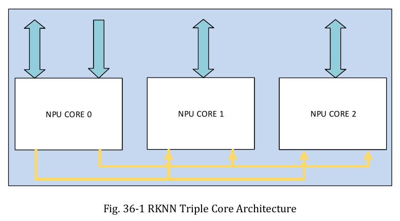

:tocdepth: 1

**************************
RK3588: nhiều core và SRAM
**************************

.. admonition:: Trang này trả lời

   - ba core làm việc cùng nhau thế nào?
   - ngoài buffer trong core, NPU có SRAM của SoC không?

.. admonition:: Tóm tắt

   - TRM ghi "Support triple core co-work, dual core co-work, and work independently" [T1 TRM1 tr.1984], nhưng cách chia việc giữa các core là `unknown`.
   - Giá trị `nn_mode` 64x32 và 96x32 chỉ gợi ý dual và triple, TRM không gắn mode nào với dual hay triple nên không viết "dual = 64x32".
   - Ở multi-cores mode, op ngoài danh sách Conv, DepthwiseConvolution, Add, Concat và vài op khác "will fallback to Core0" [T1 UG152 tr.27].
   - Đo T3 trên một model YOLOv8n trọng số ngẫu nhiên cho thấy Conv+SiLU chạy lõi 0 ở CORE_0_1_2, còn `core_mask` AUTO chỉ dùng lõi 0.
   - System SRAM có 956KB cấp tối đa cho RKNPU, không phải mặc định, và khác với buffer 384KB trong core [T1 SRAM dòng 3, dòng 21, dòng 22].
   - Độ trễ và băng thông của SRAM nhìn từ NPU là `unknown`, và cửa sổ `FD600000` không được giải thích.

.. _25-chế-độ-nhiều-core:

Chế độ nhiều core
=================

**Câu hỏi:** ba core làm việc cùng nhau thế nào?

**Nguồn nói gì**

   "Support triple core co-work, dual core co-work, and work independently" [T1 TRM1 tr.1984]

..

   "Multi-task, multi-scenario in parallel" [T1 DS tr.11]

   "This register is target for multicore mode. By single core mode keep it at 3'd0." [T1 TRM1 tr.2001, thanh ghi ``nn_mode``]

Các giá trị ``nn_mode`` ở cùng thanh ghi (TRM1 tr.2001): ``3'd0`` là "Int8 mac array 32x32 mode"; ``3'd1`` là 64x32; ``3'd2`` là 96x32; ``3'd4`` là 32x64; ``3'd5`` là 32x96.

Chọn core qua API (UG152 tr.26, mục 4.4.3.2):

   "RKNN_NPU_CORE_AUTO : Referring to automatic mode, meaning that it will select the idle core inside the NPU;" [T1 UG152 tr.26]

..

   "RKNN_NPU_CORE_0_1_2: Running on both NPU0, NPU1 and NPU2 simultaneously." [T1 UG152 tr.26]

   "For multi-cores mode (when enabling RKNN_NPU_CORE_0_1 and RKNN_NPU_CORE_0_1_2), the following ops have better acceleration" [T1 UG152 tr.27]

Danh sách op trong câu trên là: Conv, DepthwiseConvolution, Add, Concat, Relu, Clip, Relu6, ThresholdedRelu, Prelu, LeakyRelu.

   "Other type of op will fallback to Core0 to continue running." [T1 UG152 tr.27]

..

   "Add the support of single batch multi-cores of NPU for RK3588" [T1 UG152 tr.3, lịch sử phiên bản v1.4.0]

   "rknn_batch_size can improve performance (increase core utilization) only on NPU multi-core platforms, so the value of rknn_batch_size is recommended to match the number of NPU cores." [T1 API232 tr.14]

|TRM1 Fig 36-1| *Hình 2.5. Kiến trúc ba NPU core. Đường vàng nối các core; TRM không giải thích các đường này bằng chữ. Nguồn: [T1 TRM1 tr.1984, Fig. 36-1]*

**Ý chính**

- Có ba chế độ phần cứng và các tham số core mask ở API. Op ngoài danh sách trên chạy về Core0 (UG152 tr.27).
- Tổng hợp của file này: giá trị ``nn_mode`` 64x32 và 96x32 gợi ý hai và ba core ghép, nhưng TRM không gắn mode nào với dual hay triple. Không viết "dual = 64x32" như sự thật.

**Giới hạn.** Cách chia việc giữa các core (theo chiều không gian, kênh hay batch) là ``unknown``. :doc:`NPU và phần cứng </kien-thuc-nen/npu/index>` :ref:`NPU nhiều core <18-npu-nhiều-core>` (JUNG, FLEX) chỉ cung cấp bối cảnh chung. Quy tắc theo từng op trong Operator List khác danh sách của UG152 (, mâu thuẫn số 3). Đóng một phần (T1 DRV; DRV, DTS xem mục Nguồn cuối trang): ``rknpu_submit`` có ``core_mask`` và ``subcore_task[5]``, mỗi phần tử gồm ``task_start`` và ``task_number`` (``rknpu_ioctl.h:241-244,277-279``); mask lõi AUTO 0x00, CORE0 0x01, CORE1 0x02, CORE2 0x04, ``RKNPU_MAX_CORES`` = 3 (``rknpu_job.h:18,24-27``). Cấu hình RK3588 có 3 ngắt ``npu0_irq`` đến ``npu2_irq`` và ``core_mask`` = 0x7 (``rknpu_drv.c:84-88,183-197``); nếu core2 bị đánh dấu invalid thì: core0 hoặc core1 cũng invalid thì probe trả ``-ENODEV``, ngược lại dùng ``rk3583_rknpu_config`` (chip khác); core2 hợp lệ thì không có nhánh nào ở đoạn này, dùng cấu hình RK3588 (``rknpu_drv.c:1274-1288``). Khi ``num_irqs`` > 1: ``use_core_num`` là 1 hoặc 2 thì task của lõi i lấy từ ``subcore_task[i]``, là 3 thì lấy từ ``subcore_task[i + 2]`` (``rknpu_job.c:71-90,313-330``). Driver nhận sẵn phân chia task theo lõi từ userspace (runtime hoặc compiler); phần đã đọc của ``rknpu_job.c`` không cho thấy driver tự chia. Lập lịch trong driver (``rknpu_job.c``): mỗi lõi có hàng đợi ``todo_list`` riêng (``:549-550``), ``core_mask`` hợp lệ chỉ là 0x1, 0x2, 0x4, 0x3, 0x7 (``:404-424``; giá trị khác báo ``Unknown core mask``); ``core_mask`` = 0x0 (AUTO) thì driver chọn lõi có ``task_num`` hàng đợi nhỏ nhất, hòa thì lõi số nhỏ, và chạy job trên 1 lõi (``:508-538``); job nhiều lõi vào hàng đợi của từng lõi được chọn và chỉ được commit xuống phần cứng khi mọi lõi đó đã lấy job (``run_count`` giảm về 0, ``:456``), xong khi ``interrupt_count`` về 0 (``:485``). Driver không quyết định op nào chạy trên lõi nào hay cách chia tensor: đó là việc của userspace, nên câu hỏi "vì sao op khác fallback Core0" vẫn ``unknown`` (runtime và compiler là ``.so``, ngoài DRV). Đo T3 board (log T3 board 2026-10-10, lượt 2 (``tmp/04_debug-logs/2026-10-10_t3-board-silu-resize/README.md``, ``raw/summary2.json``, ``raw/*_CORE_0_1_2_layers.txt``)): ở CORE_0_1_2, Conv+ReLU, Add và 15 trong 17 Concat được chia ba lõi; Conv+SiLU (``ConvExSwish``), Split, MaxPool, Resize, Reshape, Sub, Mul, Sigmoid, ``exSoftmax13`` chạy lõi 0; ``core_mask`` AUTO chỉ dùng lõi 0 trong các bảng lớp đã đo. Driver (phần đã đọc ở mục này) không quyết định cách chia, nên đây là hành vi của runtime hoặc compiler, không phải của driver (một model: YOLOv8n trọng số ngẫu nhiên ``nc=5``, INT8, 640x640, toolkit 2.3.2, RK3588S, NPU 1 GHz, ``eval_perf`` ``fix_freq=True``).

--------------

.. _27-system-sram-dùng-chung-với-npu:

System SRAM dùng chung với NPU
==============================

**Câu hỏi:** ngoài buffer trong core, NPU có SRAM của SoC không?

**Nguồn nói gì**

   "RK3588 SOC内部含有1MB的SRAM，其中有956KB可供给SOC上各个IP所使用，已支持为RKNPU指定分配使用" [T1 SRAM dòng 3] (Tạm dịch: SoC có 1MB SRAM, trong đó 956KB cấp cho các IP, đã hỗ trợ chỉ định cấp cho RKNPU.)

..

   "SRAM可以帮助RKNPU应用减轻DDR带宽压力，目前支持为Internal和Weight两种类型内存指定分配SRAM" [T1 SRAM dòng 4] (Tạm dịch: SRAM giúp giảm áp lực băng thông DDR, hiện hỗ trợ cấp SRAM cho hai loại bộ nhớ Internal và Weight.)

   "从系统分配需求大小的SRAM给RKNPU，最大可分配956KB，且大小需要4K对齐" [T1 SRAM dòng 21]

..

   "注意：默认系统中可能已为其他IP分配SRAM，比如编解码模块，各IP分配的SRAM区域不能重叠，否则会存在同时读写出现数据错乱现象" [T1 SRAM dòng 22] (Tạm dịch: mặc định hệ thống có thể đã cấp SRAM cho IP khác, ví dụ codec; các vùng không được chồng lấn, nếu không dữ liệu bị hỏng.)

UG152 tr.49 có trường ``total_sram_size`` ("Only for RK3588, memory size of SRAM reserved for NPU") và ``free_sram_size`` ("Only for RK3588, the current available SRAM"). TRM1 tr.18 và tr.19 có hai dòng ``SYSTEM_SRAM``, một ở ``FD600000`` và một ở ``FF000000``, mỗi dòng 1MB.

**Ý chính**

- Đây là SRAM của SoC, dùng chung với các IP khác, khác với buffer bên trong core ở :ref:`Buffer 384KB trong mỗi core <26-buffer-384kb-trong-mỗi-core>`. Hai thứ không được gộp.
- 956KB là mức tối đa cấp được, không phải mặc định (SRAM dòng 21, 22).

**Giới hạn.** Cửa sổ ``SYSTEM_SRAM`` ở ``FF000000`` (1MB) khớp với Chương 34 "Share Memory" của TRM1 (tr.1965: "Support total 1024KB memory comprised of four memory blocks", dải địa chỉ ``0xFF000000~0xFF0FFFFF``) và với DTS mẫu ``sram@ff001000`` trong SRAM md. Cửa sổ ``FD600000`` (1MB, TRM1 tr.18) không được giải thích. Độ trễ và băng thông của SRAM nhìn từ NPU là ``unknown``. Cách bật và các mâu thuẫn tài liệu xem :doc:`Bộ nhớ và hiệu năng </kien-thuc-nen/bo-nho-hieu-nang/index>`.

--------------

Nguồn
=====

Các nhãn nguồn dùng trong trang này (tier, tệp, số lần trích).

.. list-table::
   :header-rows: 1
   :widths: 12 8 70 10

   * - Nhãn
     - Tier
     - Nguồn
     - Số lần
   * - ``UG152``
     - T1
     - :download:`02_Rockchip_RKNPU_User_Guide_RKNN_API_V1.5.2_EN.pdf <../../_assets/pdf/papers/05_rk3588/01_vendor_docs/03_rknn_npu/02_Rockchip_RKNPU_User_Guide_RKNN_API_V1.5.2_EN.pdf>`
     - 5
   * - ``SRAM``
     - T1
     - :doc:`SRAM usage (zh) </tai-lieu-hang/sram-usage>`
     - 4
   * - ``TRM1``
     - T1
     - :download:`01_Rockchip_RK3588_TRM_V1.0_Part1_20220309.pdf <../../_assets/pdf/papers/05_rk3588/01_vendor_docs/02_trm/01_Rockchip_RK3588_TRM_V1.0_Part1_20220309.pdf>`
     - 3
   * - ``DS``
     - T1
     - :download:`02_RK3588_Datasheet_V0.1-20210727.pdf <../../_assets/pdf/papers/05_rk3588/01_vendor_docs/01_datasheet/02_RK3588_Datasheet_V0.1-20210727.pdf>`
     - 1
   * - ``API232``
     - T1
     - :download:`01_Rockchip_RKNPU_API_Reference_RKNN_Toolkit2_V2.3.2_EN.pdf <../../_assets/pdf/papers/05_rk3588/01_vendor_docs/03_rknn_npu/01_Rockchip_RKNPU_API_Reference_RKNN_Toolkit2_V2.3.2_EN.pdf>`
     - 1
