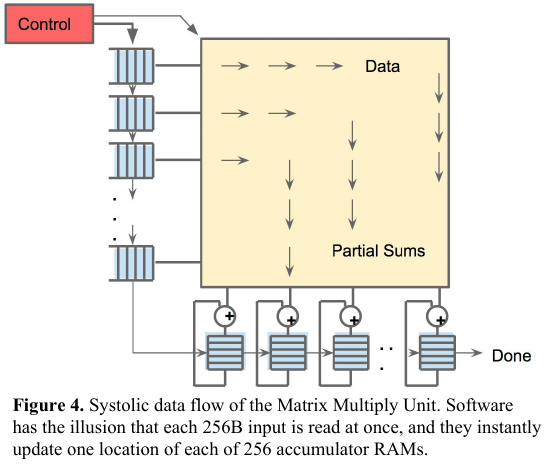

:tocdepth: 1

***************************
Systolic, sparsity, đa core
***************************

.. admonition:: Trang này trả lời

   - mảng systolic là gì và dùng để làm gì?
   - bỏ qua phép tính hoặc dữ liệu bằng 0 có giúp gì, và phần cứng có làm không?
   - chia việc cho nhiều NPU core thế nào?

.. admonition:: Tóm tắt

   - Theo TPU, systolic execution giảm số lần đọc và ghi bộ đệm lớn, và TPU không hỗ trợ sparsity [T2 TPU tr.4, tr.3].
   - RK3588 có dùng systolic array hay không là `unknown`, vì TRM Chương 36 không dùng chữ "systolic".
   - Zero-skipping của RK3588 là khái niệm riêng, được TRM mô tả qua thanh ghi `fc_skip_en`, không được đồng nhất với mô tả sparsity trong paper [T1 TRM1 tr.2006].
   - JUNG chia một lớp thành sub-layers theo chiều không gian hoặc chiều kênh để chạy song song trên multicore NPUs [T2 JUNG tr.1, tr.4].
   - Các bài dùng ba mô hình bộ nhớ khác nhau, nên không có một kiến trúc "multi-core NPU" duy nhất.
   - Cách RK3588 chia việc không được suy ra từ JUNG, vì TRM không nói RK3588 chia theo chiều không gian hay chiều kênh.

.. contents:: Trong trang này
   :local:
   :depth: 1

.. _16-systolic-array:

Systolic array
==============

**Câu hỏi:** mảng systolic là gì và dùng để làm gì?

**Nguồn nói gì**

   "As reading a large SRAM uses much more power than arithmetic, the matrix unit uses systolic execution to save energy by reducing reads and writes of the Unified Buffer" [T2 TPU tr.4]

..

   "It relies on data from different directions arriving at cells in an array at regular intervals where they are combined." [T2 TPU tr.4]

   "A given 256-element multiply-accumulate operation moves through the matrix as a diagonal wavefront." [T2 TPU tr.4]

..

   "The weights are preloaded, and take effect with the advancing wave alongside the first data of a new block." [T2 TPU tr.4]

   "The matrix unit holds one 64 KiB tile of weights plus one for double-buffering (to hide the 256 cycles it takes to shift a tile in)." [T2 TPU tr.3]

..

   "It mainly consists of a systolic array that completes the convolution computation, a weight buffer that stores the weight, a unified buffer that stores the input feature maps(ifmaps), and output feature maps(ofmaps)." [T2 LP tr.2]

   "Weight Stationary: Each PE holds a single weight in the RF at a time. The psum generated in a PE at each cycle is either passed to its neighbor PE or stored back to the global buffer, and the PE array operates as a systolic array with little local control." [T2 EYE tr.7]

|TPU Figure 4| *Hình 1.6. Systolic data flow của Matrix Multiply Unit: dữ liệu chảy vào từ bên trái, partial sums chảy xuống tới các accumulator. Nguồn: [T2 TPU tr.4, Figure 4]. Hình 2(a) của LP (kiến trúc NPU có systolic array và Systolic Data Setup) nằm ở :ref:`NPU nhiều core <18-npu-nhiều-core>`.*

**Ý chính**

- Mục đích của systolic execution theo TPU là giảm số lần đọc và ghi bộ đệm lớn (TPU tr.4).
- Tổng hợp của file này: "systolic" mô tả cách dữ liệu chạy qua mảng, còn "stationary" mô tả dữ liệu được giữ lại trong PE. Hai khái niệm không đồng nghĩa và dùng chung được. Bằng chứng: EYE tr.7 mô tả WS chạy như systolic array, còn LP tr.2 dùng systolic array với dataflow output stationary. TPU không dùng chữ "weight stationary" ở các đoạn đã trích.

**Giới hạn.** RK3588 có dùng systolic array hay không là ``unknown``: TRM Chương 36 không dùng chữ "systolic" (đã tìm).

--------------

.. _17-sparsity-và-zero-skipping:

Sparsity và zero-skipping
=========================

**Câu hỏi:** bỏ qua phép tính hoặc dữ liệu bằng 0 có giúp gì, và phần cứng có làm không?

**Nguồn nói gì**

   "The architecture can also exploit sparsity by (1) only performing data reads and MACs on non-zero values and (2) compressing the data to reduce data movement." [T2 EYE tr.7]

..

   "This unit is designed for dense matrices. Sparse architectural support was omitted for time-to-deploy reasons. Sparsity will have high priority in future designs." [T2 TPU tr.3]

   "Cnvlutin [Alb16] avoids multiplications when an activation input is zero" [T2 TPU tr.14]

**Ý chính**

- EYE nêu hai hướng: chỉ đọc và chạy MAC trên giá trị khác 0, và nén dữ liệu (EYE tr.7). Chi tiết nằm ở tài liệu EYE trích dẫn ngoài corpus.
- TPU không hỗ trợ sparsity (TPU tr.3). TPU chỉ nhắc Cnvlutin như công trình liên quan (TPU tr.14).

**Giới hạn.** Cơ chế cụ thể là ``unknown`` trong corpus. Zero-skipping của RK3588 là một khái niệm riêng, được mô tả trong TRM bằng thanh ghi ``fc_skip_en`` ("FC zero skipping enable", tác dụng là không fetch weight khi feature bằng 0) [T1 TRM1 tr.2006]. Đừng đồng nhất với các mô tả ở đây: xem file ``02_``.

--------------

.. _18-npu-nhiều-core:

NPU nhiều core
==============

**Câu hỏi:** chia việc cho nhiều NPU core thế nào?

**Nguồn nói gì**

   "By partitioning a layer of DNNs into multiple sub-layers, we can execute them in parallel on multicore NPUs." [T2 JUNG tr.1]

..

   "Multicore design consists of a compute engine and distributed, isolated local memory per core." [T2 JUNG tr.2]

   "we can easily conclude that pipelining across multiple NPU cores is inadequate on mobile devices." [T2 JUNG tr.2]

..

   "In spatial direction partitioning (Figure 5 (a)), input and output tensors are partitioned in spatial directions, that means images are segmented in half along the height or width." [T2 JUNG tr.4]

   "Channel direction partitioning (Figure 5 (b)) produces an output image partitioned along channels." [T2 JUNG tr.4]

..

   "the partitioning direction affects workload balancing due to the alignment constraints" [T2 JUNG tr.9]

   "Flexer employs a list scheduling algorithm to dynamically schedule the tiled workload to all NPUs." [T2 FLEX tr.1]

..

   "A shared on-chip scratchpad memory, labeled Global Buffer, facilitates data reuse between cores and reduces the amount of data loaded from external memory." [T2 FLEX tr.2]

   "This process is called tiling." [T2 FLEX tr.2]

..

   "when multiple NPUs execute in parallel, the data transmission congestion on NoC and DRAM is also a considerable factor in system performance." [T2 LP tr.2]

Hai kiểu chia sẻ tài nguyên khi nhiều DNN cùng chạy [T2 LP tr.1]: temporal-sharing ("in which DNNs occupy the entire hardware resources layer by" layer) và spatial-sharing ("in which each DNN model is allocated fixed hardware resources.").

|JUNG Figure 1| *Hình 1.8a. Kiến trúc SoC mobile có NPU nhiều core (NPU Core #1 đến #N nối qua Local Bus, mỗi core có Controller, Local Memory (SPM), Input, Weight, Output Buffer và Compute Engine). Nguồn: [T2 JUNG tr.2, Figure 1]*

|JUNG Figure 5| *Hình 1.8b. Hai cách chia một lớp convolution cho hai core: (a) spatial partitioning, (b) channel partitioning. Nguồn: [T2 JUNG tr.4, Figure 5]*

|LP Figure 2| *Hình 1.8c. (a) NPU có systolic array, Unified Buffer và Weight Buffer; (b) nhiều NPU nối qua router (R). Nguồn: [T2 LP tr.2, Figure 2]*

**Ý chính**

- JUNG chia một lớp thành nhiều lớp con theo chiều không gian hoặc chiều kênh để chạy song song. Lý do nêu rõ là suy luận một ảnh trên mobile (JUNG tr.2).
- Các bài dùng ba mô hình bộ nhớ khác nhau: bộ nhớ cục bộ cô lập theo từng core (JUNG tr.2), global buffer dùng chung (FLEX tr.2), và các NPU nối qua NoC (LP tr.2). Tổng hợp của file này: không có một kiến trúc "multi-core NPU" duy nhất.

**Giới hạn.** JUNG đánh giá trên "a flagship mobile SoC with three cores" [T2 JUNG tr.1], tác giả thuộc Samsung, không phải Rockchip. Cách RK3588 chia việc (triple, dual, independent) xem ``02_rk3588_npu_hardware.md`` :ref:`Chế độ nhiều core <25-chế-độ-nhiều-core>`. Đừng suy ra rằng RK3588 chia theo chiều không gian hay chiều kênh: TRM không nói.

--------------

.. _19-các-khái-niệm-bổ-sung-mà-nguồn-nhấn-mạnh:

Các khái niệm bổ sung mà nguồn nhấn mạnh
========================================

.. list-table::
   :header-rows: 1

   * - Chủ đề
     - Nguyên văn
     - Tag
   * - Convolutional reuse
     - "convolutional reuse: Due to the weight sharing property in CONV layers, a small amount of unique input data can be shared across many operations."
     - [T2 EYE tr.3]
   * - Mixed precision làm chậm matrix unit
     - "When using a mix of 8-bit weights and 16-bit activations (or vice versa), the Matrix Unit computes at half-speed, and it computes at a quarter-speed when both are 16 bits."
     - [T2 TPU tr.3]
   * - Utilization của MAC
     - "only about half of the 65,536 MACs hold useful weights because some layers in CNN1 have shallow feature depths."
     - [T2 TPU tr.6]
   * - Double buffering
     - xem :ref:`Systolic array <16-systolic-array>`
     - [T2 TPU tr.3]
   * - Tiling
     - xem :ref:`NPU nhiều core <18-npu-nhiều-core>`
     - [T2 FLEX tr.2]

**Ý chính.** Utilization phụ thuộc shape của lớp (TPU tr.6). Đây là cơ sở để các khối sau (06 và 08) hỏi vì sao kích thước kênh và dạng lớp ảnh hưởng đến tốc độ, nhưng nguồn này chỉ chứng minh cho TPU.

--------------

.. |JUNG Figure 1| image:: ../../_assets/img/npu/01_npu_fundamentals/jung_fig1.png

.. |JUNG Figure 5| image:: ../../_assets/img/npu/01_npu_fundamentals/jung_fig5.png

.. |LP Figure 2| image:: ../../_assets/img/npu/01_npu_fundamentals/lp_fig2.png

Nguồn
=====

Các nhãn nguồn dùng trong trang này (tier, tệp, số lần trích).

.. list-table::
   :header-rows: 1
   :widths: 12 8 70 10

   * - Nhãn
     - Tier
     - Nguồn
     - Số lần
   * - ``TPU``
     - T2
     - :download:`tpu_datacenter_2017jouppi.pdf <../../_assets/pdf/papers/01_hardware/tpu_datacenter_2017jouppi.pdf>`
     - 11
   * - ``JUNG``
     - T2
     - :download:`mobile_multicore_npu_2023jung.pdf <../../_assets/pdf/papers/01_hardware/mobile_multicore_npu_2023jung.pdf>`
     - 9
   * - ``LP``
     - T2
     - :download:`layer_puzzle_multicore_2023gao.pdf <../../_assets/pdf/papers/01_hardware/layer_puzzle_multicore_2023gao.pdf>`
     - 4
   * - ``FLEX``
     - T2
     - :download:`flexer_multi_npu_2023min.pdf <../../_assets/pdf/papers/01_hardware/flexer_multi_npu_2023min.pdf>`
     - 4
   * - ``EYE``
     - T2
     - :download:`eyeriss_dataflow_2016chen.pdf <../../_assets/pdf/papers/01_hardware/eyeriss_dataflow_2016chen.pdf>`
     - 3
   * - ``TRM1``
     - T1
     - :download:`01_Rockchip_RK3588_TRM_V1.0_Part1_20220309.pdf <../../_assets/pdf/papers/05_rk3588/01_vendor_docs/02_trm/01_Rockchip_RK3588_TRM_V1.0_Part1_20220309.pdf>`
     - 1
