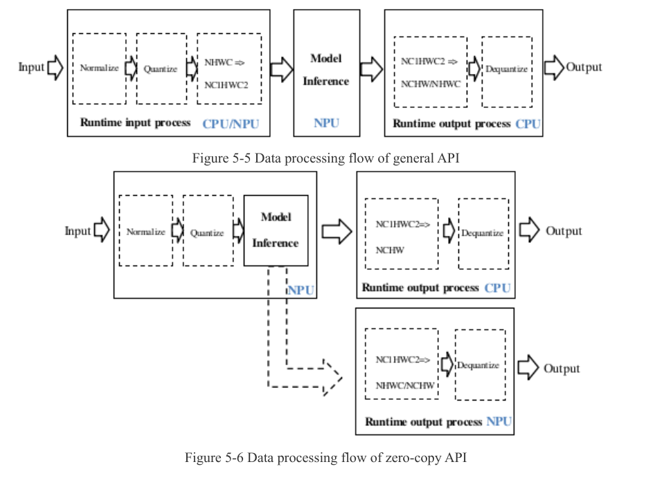

:tocdepth: 1

************
Điều chưa rõ
************

.. admonition:: Tóm tắt

   - Trang liệt kê 13 phép đo T3 cần có, chỉ liệt kê và chưa thực hiện, gồm tần số thực tế, trạng thái SRAM, A/B có và không SRAM, `eval_perf` với `perf_debug=True`.
   - Có 7 mâu thuẫn tài liệu đã ghi nhận, ví dụ runtime tối thiểu cho SRAM ">=1.3.4b14" so với ">=1.6.0", và `rknn_mem_size.reserved` là `reserved[12]` so với `reserved[10]`.
   - `RKNN_FLAG_SHARE_SRAM` có định nghĩa trong HDR dòng 72 nhưng UG232 tr.108 nói "has not yet been implemented".
   - Băng thông đỉnh DDR của RK3588S, cấu hình DRAM thực của board và việc `RW(KB)`, `DDRCycles` là đo hay tính từ mô hình đều còn `unknown`.
   - Weight SRAM bằng cờ C API còn `unknown`, và 68KB còn lại của 1MB SRAM chưa được giải thích; wheel 2.3.2 không có API Python zero-copy.
   - Định dạng `rknpu/load` lúc nhàn rỗi đã đọc được trên board ngày 2026-10-10 (Core0, Core1, Core2 đều 0%), nhưng chu kỳ lấy mẫu vẫn chưa đo.

.. contents:: Trong trang này
   :local:
   :depth: 1

.. _76-phép-đo-t3-cần-có-chỉ-liệt-kê-chưa-thực-hiện:

Phép đo T3 cần có (chỉ liệt kê, chưa thực hiện)
===============================================

.. list-table::
   :header-rows: 1

   * - #
     - Phép đo
     - Để trả lời
   * - 1
     - Tần số DDR, NPU, CPU thực tế khi chạy; xác nhận ``fix_freq`` có hiệu lực
     - tần số mặc định và khi cố định
   * - 2
     - Loại DRAM, số kênh, dung lượng thực của board
     - cấu hình DDR của RK3588S
   * - 3
     - Băng thông DDR đạt được thực tế (ví dụ ``mbw`` như EDGE tr.3)
     - thay chỗ trống của 7.1; so với 8807 MiB/s của EDGE
   * - 4
     - Trạng thái SRAM: ``dmesg``, ``rknpu/mm``, ``total_sram_size``, ``free_sram_size``
     - 956KB có được cấp thực tế không
   * - 5
     - A/B có và không SRAM trên YOLOv8n
     - độ trễ, ``Predict SRAM Hit RW Amount``
   * - 6
     - ``eval_perf`` với ``perf_debug=True``
     - DDRCycles, NPUCycles, MacUsage, RW(KB) theo lớp
   * - 7
     - ``eval_memory``
     - Weight, Internal Tensor, Other, Total
   * - 8
     - ``RKNN_QUERY_PERF_RUN`` và ``RKNN_QUERY_PERF_DETAIL`` bằng C API
     - so với ``eval_perf`` qua adb
   * - 9
     - ``rknpu/load`` khi chạy một luồng và nhiều luồng
     - định dạng đầu ra, so với MacUsage
   * - 10
     - Zero-copy so với general API, cacheable so với non-cacheable
     - chi phí copy và ``rknn_mem_sync``
   * - 11
     - Đầu ra NC1HWC2 so với NHWC
     - chi phí chuyển layout phía CPU cho đầu ra YOLO
   * - 12
     - ``core_mask`` 0, 1, 2, 0_1, 0_1_2
     - độ trễ và cột ``WorkLoad``
   * - 13
     - Tranh chấp DDR khi CPU, GPU, RGA cùng chạy
     - ảnh hưởng đến độ trễ NPU

Mâu thuẫn đã ghi nhận
=====================

.. list-table::
   :header-rows: 1

   * - #
     - Nội dung
     - Phía A
     - Phía B
   * - 1
     - Runtime tối thiểu cho SRAM
     - SRAM dòng 54: ">=1.3.4b14"
     - UG232 tr.107: ">=1.6.0"
   * - 2
     - Cách bật SRAM
     - SRAM dòng 61, 67-68: biến môi trường (có Weight)
     - UG232 tr.107: cờ ``RKNN_FLAG_ENABLE_SRAM``, chỉ Internal
   * - 3
     - ``RKNN_FLAG_SHARE_SRAM``
     - HDR dòng 72: có định nghĩa; RT232 tr.19 mô tả như dùng được
     - UG232 tr.108: "has not yet been implemented"
   * - 4
     - ``rknn_mem_size.reserved``
     - UG152 tr.49, RT232 tr.14: ``reserved[12]``
     - HDR dòng 355: ``reserved[10]``
   * - 5
     - Query input zero-copy
     - UG232 tr.69: dùng ``RKNN_QUERY_NATIVE_INPUT_ATTR``
     - ``rknn_create_mem_demo.cpp:205``: dùng ``RKNN_QUERY_INPUT_ATTR``
   * - 6
     - Node phiên bản driver
     - UG232 tr.137: ``rknpu/version``
     - UG152 tr.74: ``rknpu/driver_version``
   * - 7
     - SRAM theo chip
     - UG232 tr.106: có RK3576 (480KB)
     - RT232 tr.14, UG152 tr.49: "Only for RK3588"

Còn thiếu nguồn (unknown)
=========================

.. list-table::
   :header-rows: 1

   * - Câu hỏi
     - Truy vấn hoặc cách kiểm
   * - Băng thông đỉnh DDR của RK3588S và board; số kênh RK3588S
     - "RK3588S datasheet memory interface LPDDR4X channels bandwidth"; T3
   * - Cấu hình DRAM thực của board
     - schematic hoặc BOM chính thức của board; T3 log boot
   * - ``RW(KB)`` và ``DDRCycles`` là đo hay tính từ mô hình
     - "RKNN eval_perf DDRCycles RW(KB) definition"
   * - Định dạng đầu ra ``rknpu/load``. Đóng một phần (T1 DRV, T3): xem 7.3. Đóng (T3 board, đọc bằng sudo 2026-10-10; log T3 board 2026-10-10): ``NPU load:  Core0:  0%, Core1:  0%, Core2:  0%,`` lúc nhàn rỗi; chu kỳ lấy mẫu vẫn chưa đo
     - T3, hoặc ``rknpu_debugger.c``
   * - Weight SRAM bằng cờ C API; lý do hai version runtime khác nhau. Đóng một phần (T1 DRV, T3): ``CONFIG_ROCKCHIP_RKNPU_SRAM`` không đặt trên board nên ``rknpu/mm`` không tồn tại; hiệu lực cờ SRAM trong C API trên board vẫn ``unknown`` (xem 7.2)
     - "RKNN release notes RKNN_INTERNAL_MEM_TYPE introduced librknnrt version"
   * - Độ trễ, băng thông SYSTEM_SRAM nhìn từ NPU
     - "RK3588 TRM share memory NPU AXI slave port"
   * - 68KB còn lại của 1MB SRAM; vùng chỉ truy cập secure
     - "RK3588 system SRAM secure region size"
   * - Có API Python zero-copy không
     - wheel 2.3.2 không có
   * - T2 về thiết kế mạng cho thiết bị có DRAM và NPU
     - "layer fusion reduce DRAM traffic CNN accelerator"; "activation memory scheduling NPU edge DRAM bandwidth"

.. |UG232 Figure 8-5| image:: ../../_assets/img/npu/07_memory_performance/ug232_p140_fig8-5.png

.. |MCUNet Figure 7| image:: ../../_assets/img/npu/07_memory_performance/mcunet_p6_fig7.png
.. |PhiNets Figure 4| image:: ../../_assets/img/npu/07_memory_performance/phinets_p8_fig4.png
