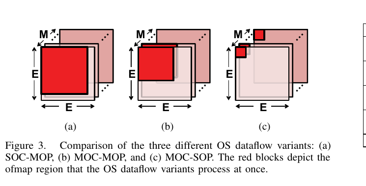
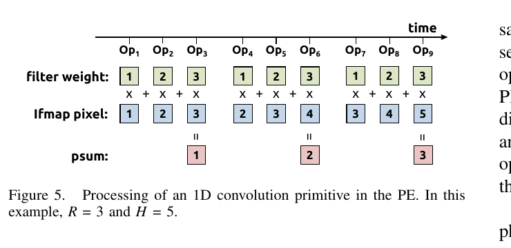
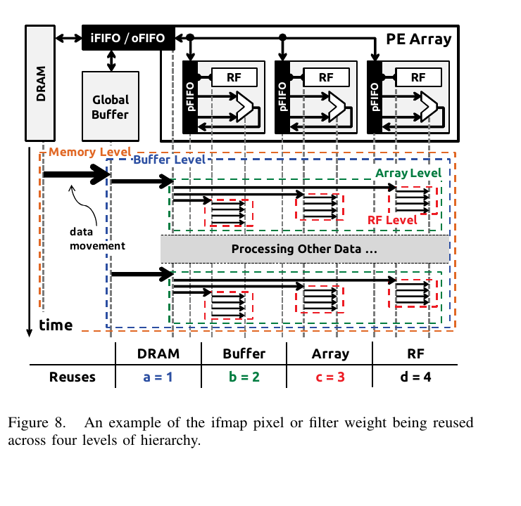
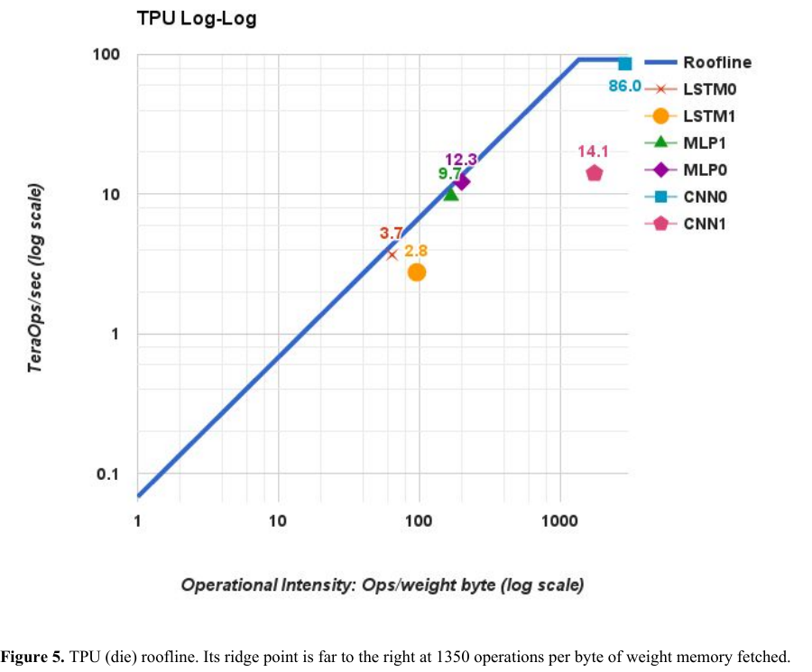

:tocdepth: 1

****************************
Dataflow, bộ nhớ và roofline
****************************

.. admonition:: Trang này trả lời

   - dữ liệu nào được giữ yên trong PE, dữ liệu nào di chuyển?
   - dữ liệu nằm ở đâu, và chi phí mỗi lần truy cập khác nhau thế nào?
   - một chương trình bị giới hạn bởi tính toán hay bởi băng thông bộ nhớ?

.. admonition:: Tóm tắt

   - Không dataflow nào tối ưu đồng thời mọi loại reuse và psum accumulation, đây là động cơ để EYE đề xuất row stationary [T2 EYE tr.4, tr.5].
   - Dataflow mà RK3588 dùng là `unknown` ở mọi nguồn T1 đã tìm.
   - Trong điều kiện đo của EYE, truy cập DRAM tốn 200x năng lượng so với 1 MAC, và số liệu này lấy từ chip 65nm [T2 EYE tr.8].
   - Chương trình không đủ operational intensity thì bị giới hạn bởi memory bandwidth, nằm dưới phần dốc của roofline [T2 TPU tr.5].
   - Kết luận MLP và LSTM bị giới hạn bộ nhớ còn CNN bị giới hạn tính toán chỉ đúng cho 6 ứng dụng NN của TPU, không suy ra cho mọi NPU hay YOLO [T2 TPU tr.6].

.. contents:: Trong trang này
   :local:
   :depth: 1

.. _13-dataflow:

Dataflow
========

**Câu hỏi:** dữ liệu nào được giữ yên trong PE, dữ liệu nào di chuyển?

**Nguồn nói gì** (EYE định nghĩa các dataflow, tr.4 đến 5, 7)

.. list-table::
   :header-rows: 1

   * - Dataflow
     - Nguyên văn
     - Tag
   * - Weight stationary (WS)
     - "Each filter weight remains stationary in the RF to maximize convolutional reuse and filter reuse."
     - [T2 EYE tr.4]
   * - Output stationary (OS)
     - "The accumulation of each ofmap pixel stays stationary in a PE."
     - [T2 EYE tr.4]
   * - Row stationary (RS)
     - "It breaks the high-dimensional convolution down into 1D convolution primitives that can run in parallel; each primitive operates on one row of filter weights and one row of ifmap pixels, and generates one row of psums."
     - [T2 EYE tr.5]
   * - RS, phần giữ yên
     - "the computation of each row pair stays stationary in the PE, which creates convolutional reuse of filter weights and ifmap pixels at the RF level."
     - [T2 EYE tr.5]
   * - No local reuse (NLR)
     - "The NLR dataflow has two major characteristics: (1) it does not exploit data reuse at the RF level, and (2) it uses inter-PE communication for ifmap reuse and psum accumulation."
     - [T2 EYE tr.5]

..

   "Unfortunately, maximum input data reuse cannot be achieved simultaneously with immediate psum reduction, since the psums generated by MACs using the same filter or ifmap value are not reducible." [T2 EYE tr.4]

   "While existing dataflows attempt to maximize certain types of input data reuse or minimize the psum accumulation cost, they fail to take all of them into account at once." [T2 EYE tr.5]

..

   "the dataflow must be efficient for different shapes, and the hardware architecture must be programmable to dynamically map to an efficient dataflow." [T2 EYE tr.4]

Nguồn phụ:

   "we adopt the commonly used output stationary as the dataflow for this paper." [T2 LP tr.2]

|Eyeriss Figure 3| *Hình 1.3a. Ba biến thể output stationary (OS); vùng đỏ là vùng ofmap được xử lý cùng lúc. Nguồn: [T2 EYE tr.5, Figure 3]*

|Eyeriss Figure 5| *Hình 1.3b. Xử lý một 1D convolution primitive trong PE (R = 3, H = 5), phần tử cơ sở của row stationary. Nguồn: [T2 EYE tr.6, Figure 5]*

**Ý chính**

- Mỗi dataflow chọn một loại dữ liệu để giữ yên (weight, ofmap accumulation, hoặc một cặp hàng) nhằm giảm số lần đọc lại dữ liệu đó.
- Không dataflow nào tối ưu mọi thứ cùng lúc (EYE tr.4, tr.5). Đây là động cơ để EYE đề xuất row stationary.
- Dataflow phải hợp với shape của từng lớp, nên phần cứng cần lập trình được để ánh xạ (EYE tr.4).

**Giới hạn.** RK3588 dùng dataflow nào là ``unknown`` ở mọi nguồn T1 đã tìm ( và 9).

--------------

.. _14-memory-hierarchy-và-chi-phí-năng-lượng:

Memory hierarchy và chi phí năng lượng
======================================

**Câu hỏi:** dữ liệu nằm ở đâu, và chi phí mỗi lần truy cập khác nhau thế nào?

**Nguồn nói gì**

   "Overall, the system provides four levels of storage hierarchy for data accesses, including DRAM, global buffer, array (inter-PE communication) and RF. Accessing data from a different level also implies a different energy cost, with the highest cost at DRAM and the lowest cost at RF." [T2 EYE tr.2]

..

   "Table IV shows the energy cost of accessing each level relative to a MAC operation under the listed conditions." [T2 EYE tr.8]

   "The numbers are extracted from a commercial 65nm process." [T2 EYE tr.8]

Giá trị Table IV (đọc từ bố cục ``-layout`` của EYE tr.8):

.. list-table::
   :header-rows: 1

   * - Tầng
     - Điều kiện
     - Năng lượng tương đối so với 1 MAC
   * - DRAM
     - 
     - 200x
   * - Global buffer
     - > 100 kB
     - 6x
   * - Array (inter-PE)
     - 1 đến 2 mm
     - 2x
   * - RF
     - 0.5 kB
     - 1x

|Eyeriss Figure 8| *Hình 1.4. Một pixel ifmap hoặc weight được dùng lại qua bốn tầng bộ nhớ (DRAM, Buffer, Array, RF). Hàng dưới của hình ghi số lần dùng lại ở mỗi tầng: a = 1, b = 2, c = 3, d = 4. Nguồn: [T2 EYE tr.9, Figure 8]*

**Ý chính.** Truy cập DRAM đắt hơn một phép MAC khoảng 200 lần trong điều kiện đo của EYE. Đây là lý do dataflow ở :ref:`Dataflow <13-dataflow>` cố giữ dữ liệu ở tầng thấp.

**Giới hạn.** Chip 65 nm. Việc áp dụng tỷ lệ này cho SoC hiện đại là ``unknown``. Năng lượng khác với băng thông (xem 1.5 và :doc:`Bộ nhớ và hiệu năng </kien-thuc/bo-nho-hieu-nang/index>`).

--------------

.. _15-roofline:

Roofline
========

**Câu hỏi:** một chương trình bị giới hạn bởi tính toán hay bởi băng thông bộ nhớ?

**Nguồn nói gì**

   "The assumption behind the model is that applications don't fit in on-chip caches, so they are either computation-limited or memory bandwidth-limited." [T2 TPU tr.5]

..

   "Without sufficient operational intensity, a program is memory bandwidth-bound and lives under the slanted part of the roofline." [T2 TPU tr.5]

   "As weights do not normally fit in on-chip memory for NN applications, the second change is to redefine operational intensity to be integer operations per byte of weights read" [T2 TPU tr.6]

..

   "the MLPs and LSTMs are memory bound, and CNNs are computation bound." [T2 TPU tr.6]

   "To amortize the access costs, the same weights are reused across a batch of independent examples during inference or training, which improves performance." [T2 TPU tr.2]

|TPU Figure 5| *Hình 1.5. Roofline của một die TPU, thang log-log. Trục X là operational intensity (Ops trên weight byte), trục Y là TeraOps/sec. Chú thích hình: ridge point ở 1350 operations per byte of weight memory fetched. Nguồn: [T2 TPU tr.6, Figure 5]*

**Ý chính**

- Roofline chia hai vùng: chạm giới hạn tính toán hoặc chạm giới hạn băng thông, và khi operational intensity thấp thì chương trình bị giới hạn bởi băng thông (TPU tr.5).
- TPU định nghĩa lại operational intensity theo "integer operations per byte of weights read" (TPU tr.6). Đây không phải FLOP trên byte DRAM theo nghĩa thông thường.

**Giới hạn.** Kết luận "MLP và LSTM bị giới hạn bộ nhớ, CNN bị giới hạn tính toán" chỉ đúng cho 6 ứng dụng NN của TPU (TPU tr.2: "Four of the six NN apps are memory-bandwidth limited"; TPU tr.6). Ngoại lệ ngay trong đoạn đó: CNN1 có operational intensity rất cao nhưng chỉ đạt 14.1 TOPS (TPU tr.6, Figure 5). Không suy ra cho mọi NPU hay cho YOLO. TPU tr.5 nói nó "adapt the Roofline Performance model from high-performance computing (HPC) [Wil09]". Bài roofline gốc không có trong corpus: xem truy vấn cuối file.

--------------

Nguồn
=====

Các nhãn nguồn dùng trong trang này (tier, tệp, số lần trích).

.. list-table::
   :header-rows: 1
   :widths: 12 8 70 10

   * - Nhãn
     - Tier
     - Nguồn
     - Số lần
   * - ``EYE``
     - T2
     - :download:`eyeriss_dataflow_2016chen.pdf <../../_assets/pdf/papers/01_hardware/eyeriss_dataflow_2016chen.pdf>`
     - 14
   * - ``TPU``
     - T2
     - :download:`tpu_datacenter_2017jouppi.pdf <../../_assets/pdf/papers/01_hardware/tpu_datacenter_2017jouppi.pdf>`
     - 6
   * - ``LP``
     - T2
     - :download:`layer_puzzle_multicore_2023gao.pdf <../../_assets/pdf/papers/01_hardware/layer_puzzle_multicore_2023gao.pdf>`
     - 1
