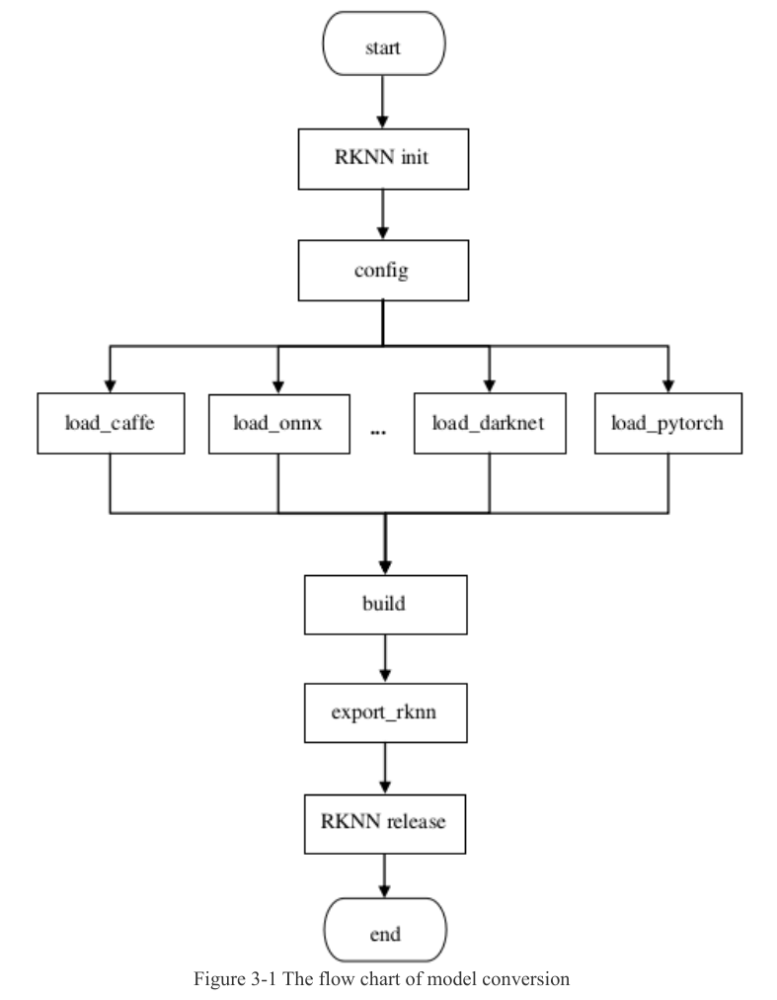
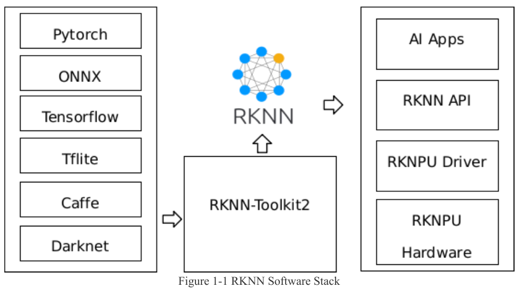
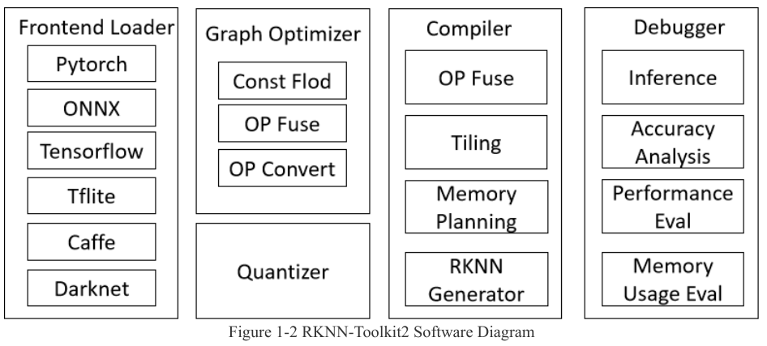
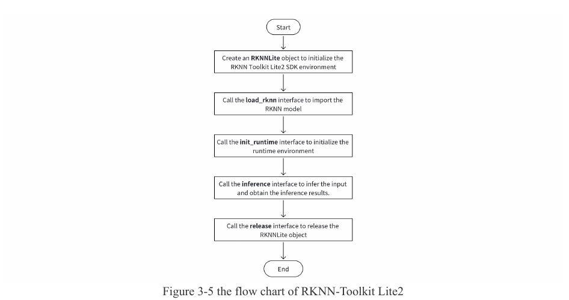
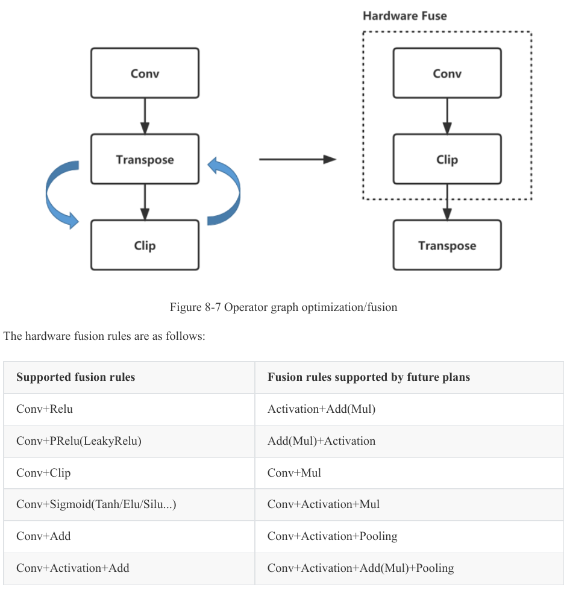

:tocdepth: 1

************
Điều chưa rõ
************

.. admonition:: Tóm tắt

   - Trang có hai bảng mâu thuẫn giữa các nguồn (7 dòng và 5 dòng), ví dụ khuyến nghị driver ">= 0.9.2" (UG232 tr.16, 155) so với "0.8.8 trở lên" (UG232 tr.136), và chỗ đặt librknnrt.so là /usr/lib64 hoặc /usr/lib.
   - Nhiều mục vẫn unknown: cách Lite2 và Toolkit2 tìm librknnrt.so, giao thức NTB, Lite2 có cần rknn_server không, và cơ chế fix_freq=True đặt tần số.
   - Danh sách và thứ tự pass của compiler, thuật toán fusion thật và thuật toán tiling với buffer 384KB mỗi core là unknown vì T1 chỉ có tên pass và tên hàm.
   - Resize mâu thuẫn giữa OPL và UG232 tr.176; đo T3 trên YOLOv8n trọng số ngẫu nhiên, INT8 cho Resize nearest 2x là Target = NPU, chưa thử bilinear hay FP16 nên chưa kết luận UG232 sai.
   - Đo T3 trên cùng model: 57 bộ Conv+Sigmoid+Mul thành 57 ConvExSwish, còn rule nào bị tắt ở optimization_level 1 và 2 vẫn unknown.

.. contents:: Trong trang này
   :local:
   :depth: 1

Mâu thuẫn và nhập nhằng đã ghi nhận
===================================

.. list-table::
   :header-rows: 1

   * - #
     - Nội dung
     - Phía A
     - Phía B
   * - 1
     - Tên Lite
     - :doc:`/thuat-ngu`: RKNN-Toolkit-Lite2
     - Nguồn vendor dùng "RKNN-Toolkit Lite2" (UG232 tr.36), lớp ``RKNNLite``, pip ``rknn-toolkit-lite2``; paper RK66 tr.4 gọi Lite2 là công cụ convert
   * - 2
     - Tham số ``init_runtime`` của Lite2
     - UG232 tr.38 đến 39: chỉ ``core_mask``
     - ``rknn_lite.py:115``: ``target``, ``device_id``, ``async_mode``, ``core_mask``
   * - 3
     - Khuyến nghị driver
     - UG232 tr.16, 155 và QS232 tr.15: >= 0.9.2
     - UG232 tr.136: 0.8.8 trở lên
   * - 4
     - Chỗ đặt ``librknnrt.so``
     - UG232 tr.18: ``/usr/lib64``
     - QS232 tr.17: ``/usr/lib``
   * - 5
     - Mẫu ``get_sdk_version``
     - API232 tr.20 vẫn in "API: 1.5.2"
     - Binary ``librknnrt`` trong cây là 2.3.2
   * - 6
     - Ví dụ nạp ONNX trong UG232
     - UG232 tr.24 viết "ONNX loading"
     - ngay dưới gọi ``rknn.load_tflite``
   * - 7
     - Có bản RKNN-Toolkit2 cho ARM Linux không
     - UG232 tr.157: "No ARM Linux version"
     - UG232 tr.11: hai bản, x86 và ARM64; UG232 tr.2 (V2.3.0): "Add support for ARM64 version of RKNN-Toolkit2" (tr.157 là mô tả cũ)

Còn thiếu nguồn (unknown)
=========================

.. list-table::
   :header-rows: 1

   * - Câu hỏi
     - Cách kiểm hoặc truy vấn
   * - Định dạng đầu ra ``rknpu/load``; ngữ nghĩa node ``power``, ``delayms``. Đóng một phần (T1 DRV, T3): xem hai dòng ``Giới hạn`` ở :ref:`Driver rknpu và các node trạng thái <54-driver-rknpu-và-các-node-trạng-thái>`
     - T3 trên board; mã nguồn kernel Rockchip
   * - Vì sao UG232 không còn nhắc node ``power``, ``freq``, ``volt``. Đóng một phần (T1 DRV): các node này vẫn có trong danh sách node gốc của driver 0.9.8: ``version``, ``load``, ``power``, ``freq``, ``volt``, ``delayms``, ``reset``, và ``mm`` chỉ khi ``CONFIG_ROCKCHIP_RKNPU_SRAM`` (``rknpu_debugger.c:304-316``). ``freq`` đọc ``clk_get_rate(clks[0])``; ghi (khi ``CONFIG_PM_DEVFREQ``) đặt ``ondemand_freq`` rồi gọi ``update_devfreq`` (``rknpu_debugger.c:177-245``); ``volt`` đọc ``regulator_get_voltage`` (``rknpu_debugger.c:247-260``). Lý do UG232 không nhắc vẫn ``unknown``; lúc đầu chưa đọc được các node trên board (T3, ``Permission denied``); sau đó đọc được bằng sudo, xem mệnh đề sau. Đóng một phần (T3 board, đọc bằng sudo 2026-10-10; log T3 board 2026-10-10): ``freq`` = 1000000000; ``volt`` = 812500, khác 850000 ở dòng ``opp-microvolt`` đầu của OPP 1000 MHz trong DTS, nên board dùng một biến thể điện áp khác (chưa biết biến thể nào).
     - lịch sử commit ``drivers/rknpu``
   * - Cách Lite2 và Toolkit2 tìm ``librknnrt.so``
     - "LIBRKNNRT_PATH rknn-toolkit-lite2"
   * - Giao thức NTB
     - "rknn-toolkit2 NTB mode npu_transfer_proxy"
   * - Lite2 có cần ``rknn_server`` không
     - T3 trên board
   * - Cách ``fix_freq=True`` đặt tần số qua node nào
     - UG232 tr.31 chỉ nói "try to fix the frequency"; cơ chế chi tiết chưa có nguồn
   * - Chạy Lite2 trên RK3588S khác RK3588 không
     - T3 (UG232 tr.158 chỉ nói model dùng chung)

.. _66-điều-chưa-biết-về-compiler-nội-bộ-của-rockchip:

Điều chưa biết về compiler nội bộ của Rockchip
==============================================

.. list-table::
   :header-rows: 1

   * - Câu hỏi
     - Vì sao unknown
     - Truy vấn hoặc cách kiểm
   * - Danh sách và thứ tự pass; thuật toán fusion thật
     - T1 chỉ có tên pass và tên hàm
     - "RKNN compiler passes RKNNTilingPass"; mã nguồn kernel driver ``rknpu`` chính thức
   * - Thuật toán tiling với buffer 384KB mỗi core
     - TRM chỉ nêu phần cứng; T2 không nói về Rockchip
     - "RK3588 NPU tiling CBUF 384KB convolution buffer allocation"
   * - Resize chạy NPU, CPU hay ConvTranspose
     - Mâu thuẫn OPL và UG232. Đóng một phần (T3 board, 2026-10-10; log T3 board 2026-10-10 (``tmp/04_debug-logs/2026-10-10_t3-board-silu-resize/README.md``)): YOLOv8n trọng số ngẫu nhiên, INT8, ``core_mask`` AUTO, toolkit 2.3.2; hai lớp Resize (nearest 2x, ``coordinate_transformation_mode=asymmetric``, ``nearest_mode=floor``) đều ``Target = NPU``, ``INT8`` ở ``optimization_level`` 1, 2 và 3. UG232 tr.176 nói ``optimization_level=2`` đưa Resize về CPU: điều đó không tái hiện ở model thử. Chưa thử bilinear, FP16 hay tham số khác, nên không kết luận UG232 sai
     - T3: ``eval_perf`` với ``optimization_level`` 3 và 2
   * - "多核联合" nghĩa chính xác; khác biệt "尚不支持", "暂不支持", "不支持"
     - OPL không định nghĩa; phép đo T3 (log T3 board 2026-10-10, lượt 2) chỉ cho WorkLoad theo lớp, không định nghĩa nghĩa
     - "RKNN 多核联合 算子 暂不支持 尚不支持 区别"
   * - ``optimization_level`` 1 và 2 tắt rule nào
     - Chỉ biết mức 2 đưa Resize về CPU. Đóng một phần (T3 board, 2026-10-10; log T3 board 2026-10-10): bảng op giống hệt ở level 1, 2, 3 trên model này; độ trễ trung vị SiLU 19.154 (level 3), 19.106 (level 2), 19.586 ms (level 1), không khác biệt có ý nghĩa vì độ trải của level 1 và 3 (17.769 đến 19.628 ms; 17.881 đến 22.277 ms) bao trùm chênh lệch. Rule nào bị tắt vẫn ``unknown``
     - "rknn.config optimization_level 2 1 0 disabled rules"
   * - Luật bắt cặp fusion thực (ví dụ Sigmoid + Mul thành Swish)
     - Không có trong T1. Đóng một phần (T3 board, 2026-10-10; log T3 board 2026-10-10): trên YOLOv8n trọng số ngẫu nhiên, INT8, 57 bộ Conv+Sigmoid+Mul trong ONNX thành 57 ``ConvExSwish`` trên NPU (còn 1 ``Sigmoid`` ở đầu ra phân loại); khi thay bằng ReLU: 51 ``ConvRelu`` và 6 ``ConvReluAdd``, ``Add`` đứng riêng giảm từ 8 xuống 2
     - T3: đọc bảng op của ``eval_perf``
   * - Cách chọn C2 và C1 cho từng tensor
     - UG232 tr.61 không giải thích log mẫu
     - "RKNN NativeShape NC1HWC2 C1 calculation RK3588"
   * - Ý nghĩa ``subc`` trong điều kiện Slice
     - OPL không định nghĩa
     - "RKNN Slice subc steps OPL RK3588"
   * - Quan hệ DPU/PPU trong TRM với tên op của OPL
     - TRM tr.2054 không nối
     - "RK3588 TRM DPU BS_CORE BN_CORE operator mapping RKNN"

Mâu thuẫn đã ghi nhận
=====================

.. list-table::
   :header-rows: 1

   * - #
     - Nội dung
     - Phía A
     - Phía B
   * - 1
     - Resize trên NPU
     - OPL tr.86, 87: có mục Resize cho RK3588
     - UG232 tr.176: "does not currently support hardware-level Resize". Đo T3 board 2026-10-10: Resize nearest 2x INT8 là ``Target = NPU`` ở ``optimization_level`` 1, 2, 3 (xem :ref:`Điều chưa biết về compiler nội bộ của Rockchip <66-điều-chưa-biết-về-compiler-nội-bộ-của-rockchip>`); chưa thử bilinear, FP16
   * - 2
     - Dilation (khác biệt giữa hai op, OPL tr.9 ghi "更新全平台 Conv Dilation 参数限制")
     - OPL tr.59 (Conv): ``dilations_h ∈ [1, 31]``
     - OPL tr.59 đến 60 (Depthwise): ``dilations_h ∈ [1, 32]``
   * - 3
     - Op hỗ trợ đa lõi
     - UG232 tr.75: Conv, Depthwise, Add, Concat, Relu, Clip, Relu6, ThresholdedRelu, PRelu, LeakyRelu
     - OPL tr.84 đến 86: Relu, Clip, PRelu, LeakyRelu ghi "暂不支持"; Concat không có dòng "多核联合" (thiếu dòng không phải mâu thuẫn); ``ThresholdedRelu`` của UG232 tr.75 không có mục nào ở OPL 3.2; T3 (log T3 board 2026-10-10, lượt 2), CORE_0_1_2: ``ConvRelu``, ``ConvReluAdd``, ``Add`` và 15 trong 17 ``Concat`` được chia ba lõi; ``ConvExSwish``, ``Split``, ``MaxPool``, ``Resize``, ``Reshape``, ``Sub``, ``Mul``, ``Sigmoid``, ``exSoftmax13`` chạy lõi 0; phép đo không có lớp ``Relu`` đứng riêng (một model: YOLOv8n trọng số ngẫu nhiên ``nc=5``, INT8, 640x640, toolkit 2.3.2, RK3588S, NPU 1 GHz, ``eval_perf`` ``fix_freq=True``)
   * - 4
     - Thứ tự fusion
     - OPL 3.2.19: ``Relu(Add(Conv(...)))``
     - UG232 tr.142: ``Conv+Activation+Add``
   * - 5
     - Add(Mul)+activation
     - OPL có AddRelu, MulRelu
     - UG232 tr.142: nằm ở cột kế hoạch tương lai

.. |UG232 Figure 5-1| image:: ../../_assets/img/npu/06_compiler_operators/ug232_p61_fig5-1_table5-1.png
.. |TVM Figure 3| image:: ../../_assets/img/npu/06_compiler_operators/tvm_p3_fig3.png
.. |TVM Figure 4| image:: ../../_assets/img/npu/06_compiler_operators/tvm_p4_fig4.png
