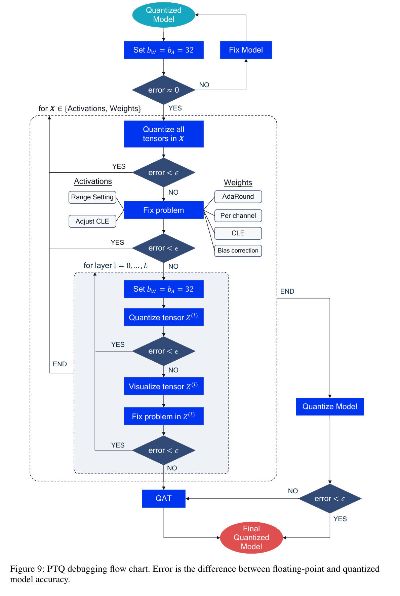
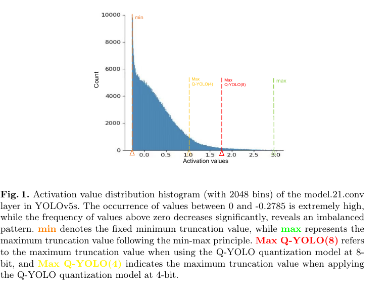
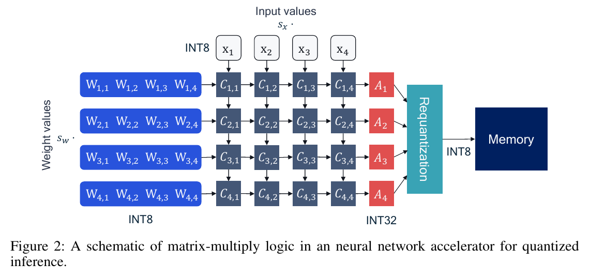
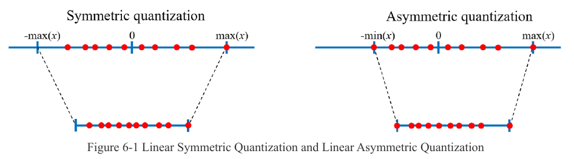

:tocdepth: 1

**************************
Điều chưa rõ: Lượng tử hóa
**************************

.. admonition:: Tóm tắt

   - Còn thiếu nguồn cho định nghĩa SQNR, thước đo sai số từng lớp cho detection, mixed-precision trên detection và lượng tử hóa YOLOv8; trang chỉ đề xuất truy vấn, chưa thực hiện.
   - Bộ tài liệu 2.3.2 có 9 mâu thuẫn, ví dụ `quantized_dtype` mặc định `"w8a8"` (API232 tr.7) so với 'asymmetric_quantized-8' (UG232 tr.22).
   - Các mâu thuẫn khác gồm mặc định của `do_quantization` (True ở API232 tr.14, 'False' ở UG232 tr.122), số ảnh calibration và dtype hybrid (chỉ float16 ở UG232 tr.124, int8, int16, float16 ở `step1.py:47`).
   - Còn `unknown`: golden tính FP32 hay FP16, hướng so sánh euclid của `auto_hybrid`, ngưỡng cosine "đạt", và hybrid int8, int16 trên RK3588.
   - Resize ảnh calibration mới đóng một phần (T3 PC, 2026-10-10): stretch toàn ảnh, nội suy có lấy trung bình, còn thiếu thuật toán chính xác.
   - `asymmetric_quantized-8` vẫn được `config()` 2.3.2 chấp nhận: `config()` trả 0 và `quant_tab` giống `w8a8` (T3 PC, 2026-10-10).

.. contents:: Trong trang này
   :local:
   :depth: 1

Còn thiếu nguồn (unknown) và truy vấn
=====================================

.. list-table::
   :header-rows: 1

   * - Chủ đề
     - Truy vấn đề xuất (chưa thực hiện)
   * - Định nghĩa và công thức SQNR
     - "Sheng 2018 quantization-friendly separable convolution SQNR"
   * - Thước đo sai số từng lớp (cosine, MSE, KL) cho detection
     - "layer-wise quantization sensitivity cosine similarity PTQ INT8 object detection"
   * - Mixed-precision đo trên detection
     - "HAWQ object detection mixed precision COCO"
   * - Lượng tử hóa YOLOv8 (SiLU, C2f, DFL, detect head)
     - "YOLOv8 post-training quantization INT8 accuracy drop"
   * - Chọn calibration set cho domain hẹp (PPE)
     - "post-training quantization calibration set size selection domain shift detection"
   * - RepConv của YOLOv7 và YOLOv6 đo trực tiếp
     - "YOLOv7 RepConv quantization INT8 accuracy"

Mâu thuẫn và nhập nhằng đã ghi nhận
===================================

.. list-table::
   :header-rows: 1

   * - Nội dung
     - Phía A
     - Phía B
   * - Dấu zero-point
     - NAGEL Eq. 4, 6: ``+z``, ``-z``
     - GHOLAMI Eq. 2, 3: ``-Z``, ``+Z``
   * - "Channel-wise"
     - NAGEL tr.5, GHOLAMI tr.7: mỗi output filter một quantizer
     - Y7Q Figure 3: mịn hơn, filter-wise là mức mỗi filter
   * - 8-bit mất bao nhiêu
     - NAGEL tr.16: "within 0.7%"; tr.25: "within only 1%"
     - NAGEL Table 6 (tr.17) EfficientDet-D1: 40.08 xuống 38.29 (W8A8 per-tensor)
   * - Weight hay activation gây sụt nhiều hơn
     - QYOLO tr.10: weight "consistently" nhiều hơn
     - QYOLO Table 3, 6-bit YOLOv5m: activation tệ hơn
   * - Mô tả MinMax
     - QYOLO tr.4: chuẩn hóa về [-1, 1]
     - QYOLO Eq. 6 (tr.6): dùng min và max của tensor
   * - Trọng tâm của "simulated quantization"
     - NAGEL tr.6: công cụ mô phỏng khi train và đánh giá
     - GHOLAMI tr.12: kiểu triển khai suy luận (không phải mâu thuẫn, chỉ khác trọng tâm)

.. |NAGEL Figure 3| image:: ../../_assets/img/npu/03_quantization_theory/nagel_p5_fig3.png
.. |GHOLAMI Figure 2| image:: ../../_assets/img/npu/03_quantization_theory/gholami_fig2.png
.. |GHOLAMI Figure 3| image:: ../../_assets/img/npu/03_quantization_theory/gholami_fig3.png
.. |Y7Q Figure 3| image:: ../../_assets/img/npu/03_quantization_theory/y7q_fig3.png
.. |NAGEL Figure 8| image:: ../../_assets/img/npu/03_quantization_theory/nagel_fig8.png
.. |NAGEL Figure 4| image:: ../../_assets/img/npu/03_quantization_theory/nagel_p6_fig4.png
.. |GHOLAMI Figure 5| image:: ../../_assets/img/npu/03_quantization_theory/gholami_p9_fig5.png
.. |GHOLAMI Figure 8| image:: ../../_assets/img/npu/03_quantization_theory/gholami_p13_fig8.png

.. |QAREP Figure 1| image:: ../../_assets/img/npu/03_quantization_theory/qarep_fig1.png
.. |QAREP Figure 4| image:: ../../_assets/img/npu/03_quantization_theory/qarep_fig4.png

.. _mâu-thuẫn-trong-bộ-tài-liệu-232:

Mâu thuẫn trong bộ tài liệu 2.3.2
=================================

.. list-table::
   :header-rows: 1

   * - #
     - Nội dung
     - Phía A
     - Phía B
   * - 1
     - ``quantized_dtype``
     - API232 tr.7 và ``rknn.py:56``: mặc định ``"w8a8"``
     - UG232 tr.22: "the default is 'asymmetric_quantized-8'"; UG232 tr.122: "only linear asymmetric INT8 quantization is supported, and the default value is 'asymmetric_quantized-8'."
   * - 2
     - Thuật toán
     - API232 tr.8: normal, mmse, kl_divergence, gdq
     - UG232 tr.122: chỉ ``'normal'``, ``'kl_divergence'``, ``'mmse'``
   * - 3
     - ``do_quantization``
     - API232 tr.14 và ``rknn.py:188``: mặc định True
     - UG232 tr.122: "with the default value being 'False'"
   * - 4
     - Số ảnh
     - API232 tr.8: normal và kl_divergence 20-100, mmse 20-50
     - UG232 tr.122, 133: 20-200
   * - 5
     - Dtype hybrid
     - UG232 tr.124: chỉ float16
     - EX ``step1.py:47``: int8, int16, float16
   * - 6
     - Hướng so sánh euclid của ``auto_hybrid``
     - API232 tr.14: "below"
     - UG232 tr.125: "the greater than euclidean distance threshold"
   * - 7
     - Tên cột ``error_analysis``
     - API232 tr.22: ``entire_error``, ``single_error``
     - UG232 tr.31: ``simulator_error``, ``runtime_error``
   * - 8
     - Golden FP32 hay FP16
     - API232 tr.22: "fp32 & quant"
     - UG232 tr.131: "RKNPU currently does not support FP32 calculations"
   * - 9
     - Phiên bản torch cho QAT
     - API232 tr.13: cần torch "1.9.0' or higher"
     - UG232 tr.127: ví dụ ghi "for 1.10 <= torch <= 1.13"

Tài liệu ``3rdparty/rknn-toolkit2/doc/RKNNToolKit2_API_Difference_With_Toolkit1-2.3.2.md`` lỗi thời (dòng 51 vẫn ``asymmetric_quantized-8``, dòng 157 ``rknn_batch_size=-1``). Không dùng làm căn cứ.

Còn thiếu nguồn (unknown)
=========================

.. list-table::
   :header-rows: 1

   * - Câu hỏi
     - Vì sao unknown
     - Cách kiểm hoặc truy vấn
   * - Resize ảnh calibration (stretch hay letterbox, interpolation). Đóng một phần (T3 PC, 2026-10-10): stretch toàn ảnh, nội suy có lấy trung bình; còn thiếu: thuật toán chính xác
     - Code là ``.so``
     - T3 thêm: phân biệt bilinear, area, antialias; model NHWC
   * - Layout và dtype của ``.npy``; mean/std có áp dụng lên ``.npy``. Đóng một phần (T3 PC, 2026-10-10): NCHW ``[1,C,H,W]`` hoặc ``[C,H,W]``, float32 và uint8 đều nhận, NHWC bị từ chối, mean/std được áp dụng; chỉ thử model ONNX NCHW
     - UG232 tr.132, 165 chỉ nói chung
     - T3 thêm: model NHWC
   * - ``quantized_hybrid_level``
     - Có trong ``rknn.py:59``, không có mô tả
     - "rknn-toolkit2 quantized_hybrid_level"
   * - Hybrid int8, int16 trên RK3588; ``proposal=False``
     - Mâu thuẫn 5 và 4.3
     - T3
   * - Hướng so sánh euclid
     - Mâu thuẫn 6
     - T3
   * - Golden tính FP32 hay FP16
     - Mâu thuẫn 8
     - T3
   * - Ngưỡng cosine "đạt"
     - UG232 tr.135 chỉ nhắc màu
     - T3
   * - Số bin, clipping của ``normal``, ``mmse``, ``kl_divergence``
     - Code là ``.so``; công thức UG232 tr.119 đến 121 là ảnh
     - "KL divergence calibration TensorRT 8-bit inference Migacz"
   * - ``asymmetric_quantized-8`` còn được ``config()`` 2.3.2 chấp nhận. Đóng (T3 PC, 2026-10-10): ``config()`` trả 0 và ``quant_tab`` giống ``w8a8`` trên model thử; thông báo lỗi của ``config()`` không liệt kê tên này trong danh sách hợp lệ
     - Mâu thuẫn 1
     - Không còn

.. |UG232 Figure 6-2| image:: ../../_assets/img/npu/04_quantization_rknn/ug232_p120_fig6-2.png
.. |UG232 Figure 6-3| image:: ../../_assets/img/npu/04_quantization_rknn/ug232_p123_fig6-3.png
.. |UG232 Figure 6-4| image:: ../../_assets/img/npu/04_quantization_rknn/ug232_p124_fig6-4.png
.. |UG232 Figure 3-2| image:: ../../_assets/img/npu/04_quantization_rknn/ug232_p30_fig3-2.png
.. |UG232 Figure 7-1| image:: ../../_assets/img/npu/04_quantization_rknn/ug232_p131_fig7-1.png
