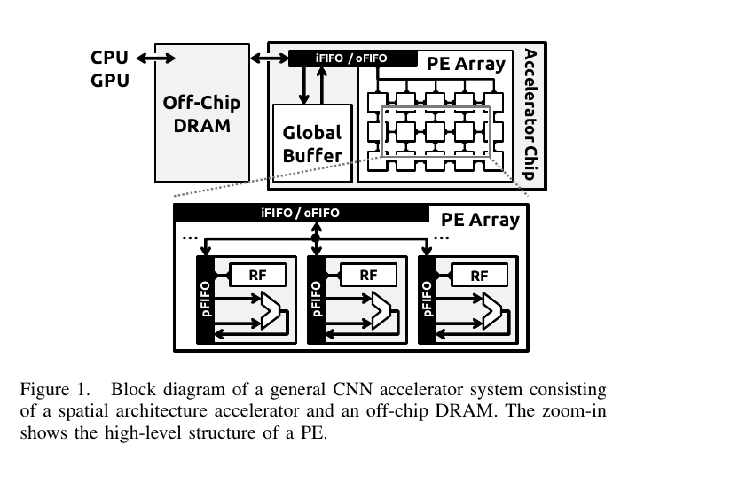
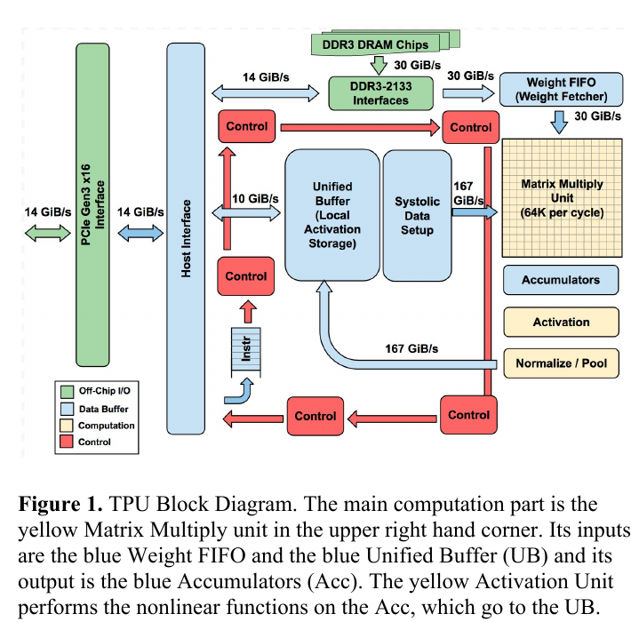
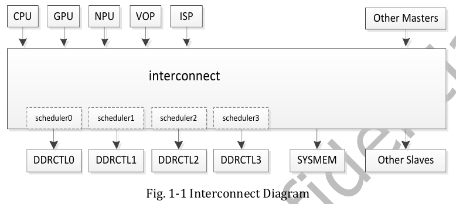
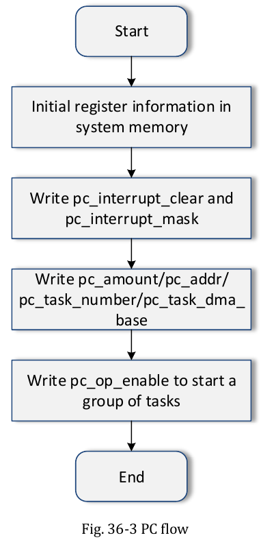

:tocdepth: 1

******************************
Điều chưa rõ: NPU và phần cứng
******************************

.. admonition:: Tóm tắt

   - Kiểu dataflow, kích thước mỗi bank của buffer 384KB và chức năng firmware của MCU NPU_M0 đều là `unknown` vì TRM không nêu.
   - Kích thước PE array chỉ biết một phần: TRM có "Int8 mac array 32x32 mode" [T1 TRM1 tr.2001], chỉ cho INT8.
   - Tần số tối đa và bảng OPP chỉ biết một phần: Datasheet ghi "Max NPU frequency ... TBD" [T1 DS tr.31], còn OPP tối đa 1000 MHz lấy từ DTS và board.
   - IOMMU của NPU và cửa sổ `FD600000` của `SYSTEM_SRAM` chỉ được làm rõ một phần, còn `FF000000` khớp TRM1 Ch.34 (tr.1965).
   - Trang liệt kê truy vấn đề xuất chưa thực hiện, và cấm viết "NPU chạy 1GHz" như tần số tối đa hoặc "Mỗi bank 48KB".

.. contents:: Trong trang này
   :local:
   :depth: 1

Còn thiếu nguồn (unknown) và truy vấn
=====================================

.. list-table::
   :header-rows: 1

   * - Chủ đề
     - Vì sao chưa có
     - Truy vấn đề xuất (chưa thực hiện)
   * - Một nguồn T2 dành riêng một đoạn phân tích lý do cần NPU
     - Chỉ có 3 lập luận rời trong khối này, cộng hai câu của BAMB tr.1
     - "efficient processing of deep neural networks: a tutorial and survey"; "domain-specific architectures for deep learning survey"
   * - Roofline nguyên bản
     - TPU chỉ "adapt" (TPU trích là [Wil09])
     - "Roofline: an insightful visual performance model for multicore architectures"
   * - Cơ chế zero-skipping và nén
     - Chi tiết ở tài liệu ngoài corpus
     - "Cnvlutin ineffectual neuron free deep neural network computing"; "Efficient Inference Engine EIE compressed deep neural network"; "Eyeriss ISSCC 2016 energy-efficient reconfigurable accelerator"
   * - Liên hệ giữa khái niệm ở đây và RK3588
     - Không nguồn T2 nào nói về Rockchip
     - xem ``02_rk3588_npu_hardware.md`` (T1)

Không dùng trong file này
=========================

- SURV Table 9 để phân loại thiết bị (xếp Jetson Xavier NX vào GPU và Jetson Nano vào NPU, mục Nguồn cuối trang).
- Con số TPU "15X-30X" và "30X-80X" như lợi ích chung của NPU: chỉ so với Haswell và K80 năm 2015.

.. |Eyeriss Figure 3| image:: ../../_assets/img/npu/01_npu_fundamentals/eyeriss_fig3.png
.. |Eyeriss Figure 5| image:: ../../_assets/img/npu/01_npu_fundamentals/eyeriss_fig5.png
.. |Eyeriss Figure 8| image:: ../../_assets/img/npu/01_npu_fundamentals/eyeriss_fig8.png
.. |TPU Figure 5| image:: ../../_assets/img/npu/01_npu_fundamentals/tpu_fig5.png
.. |TPU Figure 4| image:: ../../_assets/img/npu/01_npu_fundamentals/tpu_fig4.png
.. |JUNG Figure 1| image:: ../../_assets/img/npu/01_npu_fundamentals/jung_fig1.png
.. |JUNG Figure 5| image:: ../../_assets/img/npu/01_npu_fundamentals/jung_fig5.png
.. |LP Figure 2| image:: ../../_assets/img/npu/01_npu_fundamentals/lp_fig2.png

.. _211-điều-trm-không-nói:

Điều TRM không nói
==================

Các từ khóa đã tìm trong TRM1 Ch.36, TRM2, Datasheet, UG152, API232, SRAM và Operator List: ``dataflow``, ``data flow``, ``stationary``, ``systolic``, ``tile``, ``tiling``, ``PE array``, ``processing element``, ``loop order``, ``im2col``, ``winograd``, ``NVDLA``. Không có kết quả liên quan kiến trúc ().

.. list-table::
   :header-rows: 1

   * - Chủ đề
     - Kết quả
     - Verdict
   * - Kiểu dataflow (weight, output, row stationary)
     - Không có từ khóa nào
     - unknown
   * - Tiling
     - TRM không có thuật ngữ. Có tham số thanh ghi ``feature_grains``, ``data_entries``, ``weight_reuse``, ``data_reuse`` (TRM1 tr.2000, 2004) và tên pass ``RKNNTilingPass`` trong log của User Guide (UG232 tr.168)
     - unknown cho khái niệm, một phần cho tham số
   * - Kích thước PE array
     - TRM không dùng chữ PE. Có "Int8 mac array 32x32 mode" (TRM1 tr.2001)
     - một phần: chỉ INT8
   * - Kích thước mỗi bank của buffer 384KB
     - Bank 0 đến 7 trong thanh ghi, không có kích thước
     - unknown
   * - Tần số tối đa, bảng OPP, quy ước 1 MAC = 2 phép tính trong tài liệu vendor
     - DS tr.11 "up to 6 TOPS"; DS tr.31 "Max NPU frequency ... TBD"; tần số 1 GHz chỉ là ví dụ (UG232 tr.31, UG152 tr.73). Đóng một phần (T1 DTS, T3): OPP tối đa 1000 MHz ("RK3588 npu", DTS dòng 3534-3655), board ``max_freq`` 1000000000; Datasheet vẫn ``TBD``; chi tiết ở :ref:`Clock, DVFS và reset <28-clock-dvfs-và-reset>`
     - một phần: tối đa và OPP ``unknown``, ví dụ 1 GHz có
   * - Vai trò MCU NPU_M0
     - Ngắt ``C0_RKNN``..\ ``C2_RKNN`` và mailbox nối vào NPU_M0 (TRM1 tr.1298); chức năng firmware không được mô tả
     - unknown
   * - NPU có qua IOMMU không
     - Chương 36 không nói; UG232 tr.45 có ``iommu_domain_id`` 4GB ở mức SDK. Đóng một phần (T1 DRV, DTS; T3): ``iommus = <&rknpu_mmu>`` (DTS dòng 3478), board dùng iommu mode, hằng "4GB" không tìm thấy trong DRV; chi tiết ở :ref:`Vị trí của NPU trong SoC <21-vị-trí-của-npu-trong-soc>`
     - một phần
   * - Hai cửa sổ ``SYSTEM_SRAM``
     - ``FF000000`` khớp TRM1 Ch.34 (tr.1965); ``FD600000`` không được giải thích
     - một phần

**Truy vấn đề xuất** (chưa thực hiện; kết quả phải được mở và trích đúng trang trước khi dùng)

.. list-table::
   :header-rows: 1

   * - Câu hỏi
     - Truy vấn
   * - Dataflow, tiling, bố cục PE
     - "Rockchip RKNPU hardware architecture white paper"; "RK3588 RKNN MAC array 32x32 int8 microarchitecture"
   * - Ý nghĩa CBUF, CSC, CMAC, CNA, DDMA, SDMA, BS, BN, EW; kích thước bank
     - mã nguồn driver ``rknpu`` chính thức của Rockchip
   * - Dual và triple co-work chia việc thế nào. Đóng một phần (T1 DRV): task theo lõi lấy từ ``subcore_task[]`` do userspace gửi; lập lịch trong driver (``todo_list`` mỗi lõi, AUTO chọn lõi ít task nhất) đã đọc; vì sao op khác về lõi 0 vẫn ``unknown``; chi tiết ở :ref:`Chế độ nhiều core <25-chế-độ-nhiều-core>`
     - "Rockchip rknpu driver multi-core scheduling source"
   * - Bảng OPP, tần số tối đa. Đóng một phần (T1 DTS, T3): OPP tối đa 1000 MHz (DTS dòng 3534-3655), board ``max_freq`` 1000000000; chi tiết ở :ref:`Clock, DVFS và reset <28-clock-dvfs-và-reset>`
     - "RK3588 Datasheet V1.0 NPU maximum frequency"; ``rk3588s.dtsi`` npu opp-table trong kernel Rockchip
   * - Quy ước đếm phép tính cho 6 TOPS
     - "Rockchip RK3588 NPU 6 TOPS int8 calculation frequency"
   * - IOMMU. Đóng một phần (T1 DRV, DTS; T3): ``iommus = <&rknpu_mmu>`` (DTS dòng 3478), board dùng iommu mode; chi tiết ở :ref:`Vị trí của NPU trong SoC <21-vị-trí-của-npu-trong-soc>`
     - "RK3588 RKNPU IOMMU" (kiểm tra driver rknpu chính thức)

Không được viết
===============

- "NPU chạy 1GHz" như tần số tối đa hoặc mặc định, và "6 TOPS" như kết quả suy ra trong tài liệu vendor.
- "RK3588 chạy model INT4, BF16, TF32 qua ``rknn.config``" (Matmul C API có INT4, xem 2.4).
- "dual core = ``nn_mode`` 64x32".
- "Mỗi bank 48KB".
- "Zero-skipping là MAC bỏ phép nhân 0" hoặc ngược lại "MAC không bỏ phép nhân 0": TRM không nói.

.. |TRM1 Table 7-1| image:: ../../_assets/img/npu/02_rk3588_npu_hardware/trm1_p1093_table7-1_vd_npu.png
.. |TRM1 Fig 36-2| image:: ../../_assets/img/npu/02_rk3588_npu_hardware/trm1_p1985_fig36-2.png
.. |TRM1 Fig 36-1| image:: ../../_assets/img/npu/02_rk3588_npu_hardware/trm1_p1984_fig36-1.png

.. |TRM1 Fig 36-4| image:: ../../_assets/img/npu/02_rk3588_npu_hardware/trm1_p2054_fig36-4.png
